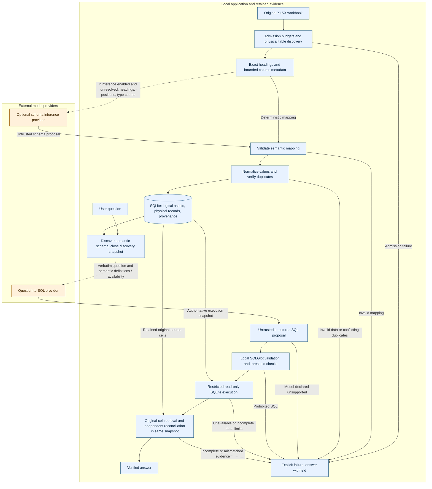

# SOVTrace engineering case study

A model-generated SQL proposal is not sufficient evidence for an answer.
SOVTrace validates the proposal, executes it within restricted boundaries and
independently reconciles the result against retained source evidence before
returning a verified answer. This case study explains that implemented boundary
and provides an offline demonstration using approved synthetic data.

## 1. Problem and supported domain

Insurance Schedules of Values (SOVs) describe insured locations, but a spreadsheet's
layout and labels do not constitute a reliable query contract. Headings can vary,
records can repeat, and recorded values can be missing or invalid. A natural-language
answer must account for these conditions rather than simply produce plausible SQL.

SOVTrace supports six concepts: asset identifier, property name, city, US state,
total insurable value (TIV) and construction type. Identifier, state and TIV mappings
are mandatory; optional concepts may be absent. An available column does not imply
that every recorded value is usable. The supported operations are existence,
logical-asset count, TIV sum and bounded asset listing, with restricted filters.

This small semantic model makes interpretation and evidence requirements explicit.
Profit, replacement-cost derivation and arbitrary spreadsheet calculations are
outside it. The application does not interpret every workbook arrangement or
calculate formulas. It uses recorded formula caches where usable, preserving the
formula and cache as evidence. The [architectural reference](ARCHITECTURE.md) and
[semantic manifest](../src/sovtrace/ingestion/manifest.py) define these boundaries.

## 2. Architecture and data flow

Ingestion and question answering have separate lifecycles. The following
source-controlled Mermaid diagram uses blue nodes for local processing and orange
nodes for external model calls. Dashed request edges identify the two distinct
provider payloads; they do not represent transmission of structured workbook rows.



[Workbook admission](../src/sovtrace/ingestion/resources.py) precedes eager parsing
and inference. Limits include 16 MiB compressed input, 64 MiB aggregate ZIP
expansion, eight sheets, row index 10,000, column index 256, 250,000 aggregate grid
positions and 100,000 explicit cells. Hidden and unselected worksheets count.
[The complete ceilings](ARCHITECTURE.md#workbook-admission-budgets) include member
limits and malformed-archive checks; these are bounded-input controls, not a
comprehensive denial-of-service guarantee.

[Discovery](../src/sovtrace/ingestion/discovery.py) locates one supported physical
table, checks its boundaries and separates excluded summary rows. Exact headings
take precedence over optional inference. Local validation checks any proposed
mapping against column positions, types and required concepts. Normalization and
[persistence](../src/sovtrace/ingestion/persistence.py) retain source cells,
metadata, completeness and logical identities. Publication is atomic; replacement
requires an explicit flag.

For each question, [the service](../src/sovtrace/qa/service.py) discovers semantic
context, closes the discovery connection and obtains one structured proposal.
It then opens a fresh authoritative read snapshot, checks dataset identity and
semantic compatibility, validates the proposal, executes it and reconciles evidence.
No database connection is held during generation. A dataset change between
discovery and execution causes failure rather than reuse of stale context.

## 3. Trust boundaries and fail-closed behaviour

Both semantic mappings and SQL proposals from a model are untrusted. Structured
output checks shape and consistency; local rules decide whether a proposal is
admissible. [SQLGlot validation](../src/sovtrace/qa/validation.py) accepts a single
SELECT from `assets`, prescribed projections and compatible literal predicates.
It canonicalizes SQL and validates the serialized statement again before execution.
The application executes that validated statement, not arbitrary original model text.

The allowlist excludes mutations, other tables, joins, aliases, CTEs, subqueries,
GROUP BY, HAVING, DISTINCT, windows, set operations, comments, LIMIT/OFFSET and
arbitrary expressions or functions. Lists must include asset identity and use
stable identity ordering. SQL text, AST size, nesting and literal sizes are bounded.
These restrictions reduce both execution authority and the complexity of complete
reconciliation. [Execution](../src/sovtrace/qa/execution.py) adds read-only opening,
query-only mode, disabled extension loading, SQLite limits, a statement authorizer
and deadlines. Internal metadata/evidence reads have separate permitted access;
model SQL cannot use those privileges.

Different outcomes carry different meanings:

| Outcome | Meaning |
| --- | --- |
| `unsupported_question/model_unsupported` | The provider's structured proposal declares the request unsupported. |
| `sql_validation_error/unsupported_sql` | Deterministic local grammar checks reject the SQL proposal. |
| `unavailable_field` or `data_incomplete` | Required concepts or usable underlying values are unavailable. |
| Evidence/reference/reconciliation failure | The application cannot establish complete, consistent source support. |
| Verified existence `false` | A successful negative answer with zero matching assets, not a refusal. |

A SUM over no matching records remains a no-matching-records outcome rather than
an invented known zero. Missing filter values cannot be treated as known nonmatches.
There is no automatic SQL repair loop. [QA tests](../tests/test_qa.py) and
[evidence tests](../tests/test_evidence.py) exercise these distinctions. Validation
and reconciliation establish support for the executed interpretation; neither
proves that a model understood the user's natural-language intent correctly.

## 4. Exact monetary arithmetic

[Normalization](../src/sovtrace/ingestion/normalize.py) uses Decimal, including exact
numeric XML values retained independently of openpyxl's ordinary numeric view.
It stores signed 64-bit integer micro-USD: one dollar is 1,000,000 units. Inputs
with more than six fractional dollar places are rounded half-up to micro-USD and
qualified as precision reduced. Missing or invalid values remain unavailable;
nonfinite values do not become usable valuations.

The signed storage range is approximately plus or minus $9.22 trillion per value.
Unsupported decimal precision (more than 1,000 coefficient digits or exponent
magnitude above 1,000) and out-of-range values are rejected. Ingestion also bounds
positive and negative logical subtotals separately so filtered integer sums cannot
overflow SQLite's signed 64-bit accumulator. This deliberately rejects some
populations whose final net total would fit but whose intermediate sums might not.

SQLite aggregation and integer predicates preserve the stored units. Recognized
explicit currency thresholds in questions are checked for exact representability,
scale and inequality against the validated SQL. Reconciliation computes an
independent Python integer sum. Structured monetary JSON uses decimal strings to
avoid downstream floating-point loss. [Presentation](../src/sovtrace/presentation.py)
rounds to cents half-up; a two-decimal display is not the full stored precision.
[Monetary boundary tests](../tests/test_monetary_thresholds.py) cover strict
thresholds, range and representability.

## 5. Provenance and reconciliation

A physical worksheet record and a logical asset are different entities. Repeated
identifiers consolidate only when all compared original cells establish equality,
including usable formula caches where applicable. Conflicting records reject the
import. Every verified duplicate still has its own source-row association.

Provenance retains workbook filename and hash, worksheet, original row and column
positions, headings, cell coordinates, types, original values, formulas and caches.
The imported database retains the evidence needed for supported queries; the XLSX
need not remain available. This is retained source evidence, not a later reread of
a potentially changed workbook, and it is not a cryptographic guarantee against
arbitrary database tampering.

[Evidence reconstruction](../src/sovtrace/qa/evidence.py) validates source references
and mappings, reconstructs normalization using ingestion's normalization rules and
checks those reconstructed values against logical contributors. Reconciliation
then independently checks identities, counts, exact sums or projected listing
values against the executed result. It is independent arithmetic and source
reconstruction, not a second model's opinion or a wholly separate normalization
implementation.

Result execution, completeness checks and evidence retrieval share one read
snapshot. Complete contributing evidence is required: the current limit is 500
logical contributors, with separate source-row, source-cell and time budgets.
Large aggregates can therefore fail even if SQLite could compute them quickly.
The application returns an explicit failure instead of sampling evidence and
presenting it as complete.

Reproduce the complete terminal walkthrough:

```sh
uv sync --locked
uv run --locked python scripts/case_study_demo.py
```

[The script](../scripts/case_study_demo.py) imports only
[`synthetic-sov.xlsx`](../examples/synthetic-sov.xlsx), explicitly disables inference
and uses a temporary database. Its small `simulated-case-study-sql-generator`
returns three predetermined proposals through the public `ask` service. Ingestion,
validation, execution and evidence reconciliation run normally. It checks every
outcome before rendering the completed walkthrough.

Observed successful-query and evidence excerpts (not the complete transcript):

```text
   Question: What is the aggregate TIV of Arizona assets?
   Executed SQL: SELECT SUM(total_insurable_value_micro_usd) FROM assets WHERE state = 'AZ'
   Answer: $20,000,000.00
   Exact value: 20000000000000 micro-USD
   Contributors: 2 logical assets; 3 physical source records.
   Reconciled: True; complete: True; same snapshot: True.
```

```text
   Asset SYN-001, row 2: A2, D2, E2
   Asset SYN-001, row 3: A3, D3, E3
   Asset SYN-002, row 4: A4, D4, E4
```

The returned source is `synthetic-sov.xlsx`, worksheet `Statement of Values`.
Rows 2 and 3 represent one verified duplicate asset; row 4 represents the other
Arizona asset. The displayed coordinates are the complete returned contributing
cell references for this question, not every cell in those workbook rows. The
existing eight-case JSON demonstration exposes full demonstrated source-cell
coordinates through `uv run --locked python scripts/demo.py --format json`.

The walkthrough separately sends a simulated unsupported profit proposal through
`ask`, requiring `unsupported_question/model_unsupported`. That simulated
model-declared refusal predicts nothing about a live model's refusal behaviour.
It then supplies `SELECT COUNT(*) FROM sqlite_master`, requiring
`sql_validation_error/unsupported_sql` before result execution. These are
deterministic application demonstrations, distinct from an empty successful
result. [Focused tests](../tests/test_case_study_demo.py) guard both boundaries,
negative existence, offline execution, stable output and failure handling.

## 6. External model use and privacy

The [schema adapter](../src/sovtrace/ingestion/provider.py) can send original
headings verbatim, column indices/letters and bounded local type-count metadata
when inference is enabled and concepts remain unresolved. CLI ingestion defaults
to enabling inference for unresolved optional as well as required concepts;
the Python API defaults off. Fully mapped inputs need no request.
`--no-infer-schema` prevents this inference path. Local proposal validation still
controls acceptance; a technical inference failure can fall back to exact mappings
only when required concepts are already mapped.

The separate [SQL adapter](../src/sovtrace/qa/provider.py) sends the user's question
verbatim plus semantic field definitions, types and availability. Disabling schema
inference does not disable question generation. Neither adapter separately serializes
workbook rows, source-cell values, full datasets or returned evidence as those
structured records. However, headings and questions can themselves contain names,
amounts, identifiers, paths or formulas. They are not generically redacted.

Both adapters set `store=False`. This does not establish zero retention, absence
of logging, absolute locality or zero exposure. Authentication and SDK metadata,
provider account policies, proxies and instrumentation require separate assessment.
The [README privacy section](../README.md#what-leaves-the-machine) describes these
boundaries and the existing optional authenticated `sovtrace ask` route. Live use
requires authorized credentials, approved inputs and account/model access, and may
incur charges. It never runs automatically in this walkthrough, tests or offline CI.

## 7. Evaluation and reproducibility

The [synthetic corpus](../src/sovtrace/evaluation/corpus.py) declares artificial
populations, layout variants, question outcomes and evidence oracles independently
of observed application results. The evaluator distinguishes supported answers,
expected unsupported/unavailable refusals, expected ingestion rejections and
unexpected infrastructure failures. [Evaluation tests](../tests/test_evaluation.py)
protect reporting and oracle comparison.

A fresh offline run on **2026-11-09 UTC**, against revision
`3d824a8f4e1f0f2b5c7b490321742cb28e752980` with the case-study working-tree additions,
reproduced 14 artificial fixtures, 80 declared question outcomes, 76 passing supported
outcomes, four passing expected unsupported/unavailable refusals and four separately
passing expected ingestion rejections. All fixtures passed; no unexpected failures
occurred. Versions were `synthetic-report-v3` and `synthetic-corpus-oracle-v1`;
provider identifiers were fixed/injected `fake-schema` and `fake-sql`, with **zero
actual model calls**. Reproduce the report with:

```sh
uv run --locked python scripts/verify_synthetic.py --offline
```

The existing evaluator writes ignored local reports under
`data/generated/synthetic-evaluation/`, recording UTC timestamp, Git SHA, tracked-tree
dirty status, versions, providers and outcomes. These figures verify fixture/oracle
agreement in offline mode. They are not measured LLM accuracy, model latency,
throughput, price or comparative performance. Actual model evaluation is a separate
opt-in pathway and was not performed for this case study.

[Offline CI](../.github/workflows/offline.yml) uses locked dependencies, removed
provider credentials and a Python startup network guard for tests and demonstrations.
Dependency installation may require package-network access. The guard prevents
network operations in the intended Python processes; it is not operating-system-wide
isolation. The new walkthrough itself writes no persistent database or evaluation
artifact. Deterministic success establishes these fixed examples and enforcement
paths, not correctness for unseen workbook structures or arbitrary user language.

## 8. Engineering decisions and trade-offs

The bounded domain gives concepts and operations concrete evidence semantics, at
the cost of expressiveness. Local SQLite provides explicit transactions, exact
integer arithmetic and a compact retained dataset, but requires schema, metadata
and provenance validation alongside the SQL engine. An SQL allowlist keeps the
execution surface reviewable and contributor selection tractable, while excluding
many legitimate analytical queries.

Exact arithmetic avoids monetary ambiguity introduced by binary floats, but adds
units, input precision policy and range checks throughout ingestion, querying and
presentation. Complete provenance makes returned answers inspectable and permits
independent arithmetic checks, but costs storage, reconstruction work and hard
evidence limits. Duplicate consolidation avoids double-counting while making the
physical/logical distinction essential to every count and explanation.

Explicit failures preserve uncertainty about missing data or unverifiable evidence.
They also mean fewer answers: an otherwise fast aggregate or plausible SQL can be
withheld. These choices add operational complexity and tests for contracts between
components. Correct natural-language interpretation remains a dependency even when
all deterministic checks pass; the system's verification claim stays bounded to
the validated interpretation and retained evidence.

## 9. Limitations and future considerations

Supported layouts, US-state semantics, six concepts and four operations constrain
coverage. Formula caches can be stale or missing; SOVTrace does not recalculate
workbooks or establish the business truth of recorded values. Complete evidence
limits bound result populations, and independent reconstruction shares normalization
code with ingestion. Snapshot consistency addresses concurrent reads, not external
source authenticity or unrestricted database tampering.

Potential future work could examine broader independent interpretation evaluation,
additional explicitly specified domains or scalable complete evidence strategies.
Each would require its own contracts and reproducible evidence. These are
considerations, not implemented features or commitments to the v0.1.0 roadmap.
This milestone supplies case-study and demonstration readiness; public release
remains a separate gate.
